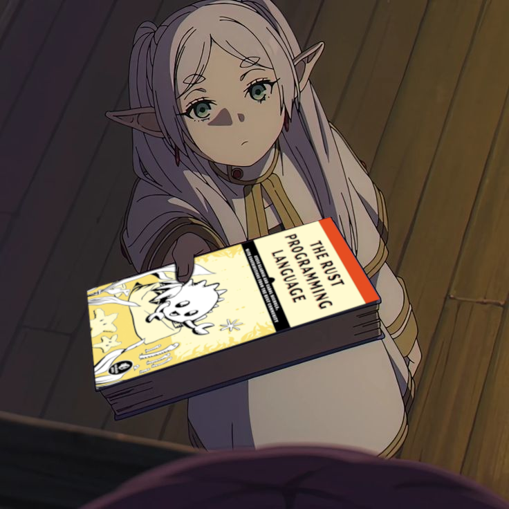

i code sometimes

**Looking for tech internship/co-op placements Summer 2027!**

## Highlights

* **President's Scholar** & Computer Science Honours (Co-op) @ [University of Manitoba](https://umanitoba.ca/), double minoring in **Mathematics** and **Film Studies**
* **IT Intern** @ [KGS Group](https://www.kgsgroup.com/), building full-stack applications using React, ASP.NET Core, SQL Server, FastAPI, vLLM, and Azure Pipelines
* Ex-**AI Engineer Intern** @ [PIXTA Vietnam](https://pixta.vn/), done R&D on AI projects using PyTorch, HuggingFace, Milvus, ClearML
* **Best Paper Award** @ [Western Canada Conference on Computing Education 2026](https://event.fourwaves.com/wccce2026) for [Trinket Exercises for In-Class Active Learning in Intro Programming Classes](https://hci.cs.umanitoba.ca/Publications/details/trinket-exercises-for-in-class-active-learning-in-intro-programming-classes) — _Devon Blewett, Lara De Leon, **Peter Vu**, Celine Latulipe_
* Ex-**Undergraduate Research Awards Holder** @ [Geometric, Approximation & Distributed Algorithms Lab](https://home.cs.umanitoba.ca/~gada/), currently first authoring a paper on graph theory pursuit-evasion problems
* **5x Hackathon Winner** (Best Cybersecurity Hack @ [.devHacks 2025](https://devclub.ca/devhacks/2025), Most Impactful Hack @ [UWinnipeg Hacks](https://uwinnipeg-hacks.devpost.com/), Smart Vaccine Reminder & Eligibility System @ [.devHacks 2026](https://devclub.ca/devhacks/2026), Winner @ [Talent Tank](https://luma.com/mghatszr), 1st Place @ [2026 Winnipeg Open Data Datathon](https://www.meetup.com/winnipeg-open-data-meet-up-group/events/312886562/))
* **2x Capture The Flag Winner** ([The Long Con 2025](https://thelongcon.ca/), [CSSA Capture The Flag 2026](https://umanitobacssa.ca/events/capture-the-flag-2026))
* **1x Game Jam Winner** ([CSSA Game Jam 2025](https://umanitobacssa.ca/events/game-jam-2025))
* **1st Place** @ [University of Manitoba Math Bee 2025](https://sites.google.com/view/umgradmathsociety/ummb/past-competitions), Canada's top-scoring team @ [Jerry Heuer Mathematics Team Contest](https://www.northcentral.maa.org/teamcontest) (2023, 2025)
* ~2 years of teaching, grading and tutoring experience across Computer Science and Mathematics
* **President** @ [.devClub](https://devclub.ca/), largest undergraduate software development club in Manitoba
* **University of Manitoba Head Delegate** @ [Canadian University Software Engineering Conference 2027](https://2026.cusec.net/), largest student-run tech conference in Canada
* Ex-**Director of Student Affairs** @ [Computer Science Students' Association](https://umanitobacssa.ca/), founded the Student Resources committee and the [First Year Guide](https://umanitobacssa.ca/resources/guides/first-year-guide) + [Second Year Guide](https://umanitobacssa.ca/resources/guides/second-year-guide) helping thousands of students navigate their degree; built said Next.js pages to render Markdown-as-HTML
* Raised **$4,000+** for charity back home organizing a [Japanese cultural festival](https://www.facebook.com/ichigoichiehajv) with **4,000+** attendees as a high school student

## Other Stuff

* Find me on [LinkedIn](https://www.linkedin.com/in/petervu298/)
* Favorite hackathon stack: Next.js (TypeScript) + FastAPI + Supabase + Groq
* Most interdisciplinary Computer Science student (as you can see above), currently digging into computer graphics and embedded programming
* Probably will build an EdTech startup
* Cat person

